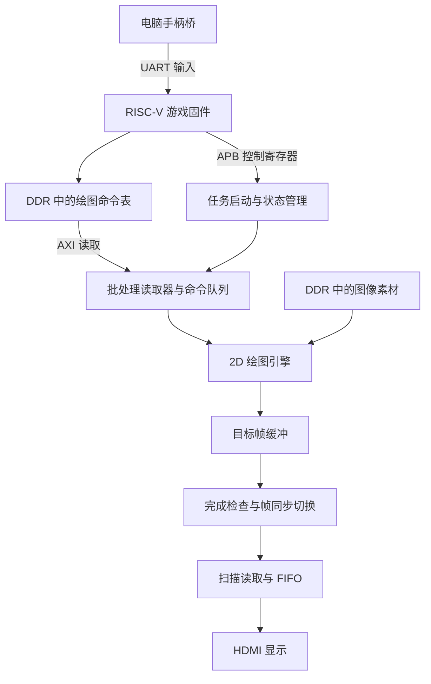

# Ti60 二维图形渲染加速工程：我的理解与学习记录

> 本文整理自对 Ti60_FIN2_HUD2 工程的源码阅读和讨论，是可持续修订的学习笔记。实现细节以对应版本源码为准；历史验收结果不代表本次重新测试。更新日期：2026-11-09。

## 1. 项目要解决什么问题

我们参加的是赛题二：基于 RISC-V 与 FPGA 异构架构的 2D 图形渲染加速引擎。

我的理解是，这道题要实现一套软硬件协同的二维图形系统：RISC-V 处理游戏和界面的高层逻辑，FPGA 完成大量重复的像素搬运、填充与混合，最后把画面输出到显示器。

例如，一张 32×32 的图包含 1,024 个像素。大量图像同时移动时，CPU 如果逐个读取、判断、混合并写入像素，还要同时执行游戏逻辑，就容易出现处理时间不足的问题。透明混合通常还需要读取目标位置的背景，访存量会进一步增加。

因此，项目把“描述一项绘图任务”和“执行这项任务的所有像素操作”分开。游戏演示既是应用，也是观察加速器在实际负载下表现的场景。

## 2. 竞赛要求与工程的对应关系

根据《易灵思 FPGA 创新设计赛道选题指南》第 7–9 页，赛题二的主要要求与工程的对应关系如下。

| 赛题要求 | 工程中的实现思路 |
| --- | --- |
| RISC-V 运行游戏或图形界面逻辑 | C 固件管理场景、菜单、输入与绘图调度 |
| 硬件块拷贝与纯色填充 | 2D DMA / BitBlt 引擎处理矩形区域 |
| 通过系统总线直接访问内存 | 绘图引擎通过 AXI 访问 DDR |
| 突发传输与内部 FIFO | 用连续数据传输和内部缓冲降低等待开销 |
| 双缓冲避免画面撕裂 | 工程采用三缓冲和显示切换队列 |
| CPU 与硬件渲染帧率对比 | 提供 CPU/FPGA 对比模式 |
| 硬件 Alpha 混合 | 读取前景、背景并完成混合计算 |
| Color Key 透明色处理 | 跳过指定透明色像素 |
| 高负载游戏演示 | 游戏、数量压力和尺寸/混合测试 |

赛题最低显示要求为 640×480@60Hz，工程采用 1280×720 的显示配置。满足要求的程度还应结合具体场景、实测指标和源码核对，不能只看是否存在同名模块。

## 3. 整体架构与软硬件分工

RISC-V 软核也是由 FPGA 内的逻辑资源实现的处理器，它执行编译后的 C 固件。自定义绘图模块则作为专用硬件电路工作。两者构成同一 FPGA 内的异构系统。

| 部分 | 我对职责的理解 |
| --- | --- |
| RISC-V 与游戏固件 | 更新游戏状态、组织场景、处理菜单与输入、提交和调度绘图任务 |
| 控制寄存器 | 配置任务参数，启动任务，读取能力、状态、错误及性能计数 |
| 批处理读取器和命令队列 | 读取命令表，检查任务并按顺序交给绘图引擎 |
| 2D 绘图引擎 | 执行填充、拷贝、透明色处理、Alpha 和 Add 混合 |
| DDR | 保存图像素材、绘图命令、对象数据和帧缓冲 |
| 显示扫描模块 | 从已完成的帧缓冲持续读取像素 |
| HDMI 输出模块 | 按固定显示时序输出画面 |
| 专用弹幕硬件 | 分担部分高负载弹幕处理，属于基础 BitBlt 之外的扩展 |

下图概括主要的帧缓冲绘图路径；专用弹幕和叠加模块的细节没有全部画入：



## 4. 一帧是怎样产生的

按固件中的帧调度逻辑，可以这样理解一帧的主要过程：

1. 读取输入并更新当前游戏或演示模式的状态。
2. 选择不在显示、也没有排队等待显示的帧缓冲区作为绘图目标。
3. 按当前模式需要启动专用弹幕处理，并准备目标画面的清理或背景恢复。
4. 根据场景组织背景、飞船、爆炸和 HUD 等绘图命令。
5. 批量提交命令，让 FPGA 执行绘图。
6. 等待相关硬件任务完成，确认结果和错误状态满足要求。
7. 将画面与对应的叠加数据作为待显示任务提交。
8. 硬件在安全的帧边界切换显示目标，继续输出下一帧。

这些工作可以有部分重叠，但缓冲区归属、任务序号和完成检查必须正确。图像数据还没写完就显示，或者 CPU 提前覆盖硬件正在读取的命令表，都可能产生错误。

## 5. 绘图命令为什么重要

统一命令接口把游戏代码和底层总线控制连接起来。游戏层描述“画什么”，硬件按地址、尺寸和模式执行。

工程的原生绘图命令包含 8 个 32 位字段，共 32 字节：

| 字段 | 含义 |
| --- | --- |
| command | 操作类型、功能开关及相关参数 |
| source | 源图像地址 |
| destination | 目标图像地址 |
| wh | 打包的宽度和高度 |
| source_stride | 源图每行起点之间的字节距离 |
| destination_stride | 目标画面每行起点之间的字节距离 |
| color | 填充颜色或透明色等参数 |
| magic | 命令格式识别标记 |

例如，把一张 32×32 的 RGB565 飞船图画到画面坐标 (300, 200)：

```text
源地址：飞船素材在 DDR 中的起点
目标地址：目标帧缓冲起点 + 200 × 2560 + 300 × 2
宽度、高度：32、32
源步长：32 × 2 = 64 字节（假设素材紧密排列）
目标步长：1280 × 2 = 2560 字节
操作：拷贝，并启用透明色处理
```

32×32 图像包含 2,048 字节像素数据，而 CPU 描述这项任务只需一条 32 字节命令。像素仍然需要由硬件读取和写回，但 CPU 不必亲自循环搬运每一个像素。这个对比说明 CPU 工作量如何降低，不代表 DDR 总流量减少了同样倍数。

## 6. APB、AXI 和 DMA 的关系

我把它们理解为控制与数据搬运的分工：

- **APB**：主要访问控制寄存器，例如任务参数、启动信号、状态和性能计数。
- **AXI**：承担访问 DDR 的数据传输，包括命令读取和图像读写。
- **DMA**：让硬件根据配置直接访问内存，CPU 无需逐项搬运数据。

CPU 可以先将命令写进 DDR，再通过寄存器告诉硬件命令表的位置和数量。批处理模块取回命令，绘图引擎再通过 AXI 访问对应的素材和目标画面。

AXI 接口用 VALID/READY 握手协调传输。只有双方同时满足条件，当前数据才被接受；遇到内存或内部缓冲暂时无法接收的情况，就需要等待并保持数据稳定。

## 7. 几种像素操作怎样工作

### 纯色填充

向目标矩形区域写入指定颜色，不需要读取源图。适合清屏或绘制简单色块。

### 图像拷贝

读取源图像素并写入目标区域。引擎利用宽高计数和行步长，在每一行结束时正确推进地址。

### Color Key

预先指定一个颜色作为透明色。源像素等于该颜色时不覆盖目标，否则执行绘制。工程使用的透明色常量为 RGB565 的 0xF81F。

它解决的是不规则图像边缘的问题：素材虽然按矩形存放，飞船外面的背景色可以被跳过。

### Alpha 混合

对前景和背景按权重进行合成。概念公式为：

```text
输出颜色 = 前景颜色 × α + 背景颜色 × (1 - α)
```

α 接近 0 时主要看到背景，接近 1 时主要看到前景。工程用整数透明度参数和 RGB565 像素进行处理，具体舍入和定点运算应以源码为准。

混合需要目标位置当前的背景，因此图层顺序会影响结果。一般先画背景，再画实体，最后叠加半透明效果。

### Add 混合

将按透明度缩放的前景亮度加到背景上，并限制颜色范围，适合辉光和爆炸等效果。它与普通 Alpha 混合的视觉效果及计算方式不同。

## 8. 为什么性能优化要关注 DDR

大量绘图任务会反复访问内存。例如，对一个像素进行 Alpha 混合，通常涉及读取前景、读取背景、写回结果。即使算术电路足够快，内存等待仍可能限制帧率。

工程采用的主要思路包括：

- 突发传输：一次连续搬运一段数据，减少事务开销。
- 内部 FIFO 和 bank 缓冲：容纳等待处理或等待写回的数据。
- 流水线重叠：让不同数据块的读取、混合和写回尽量同时推进。
- 缓存和预取：在合适条件下减少重复读取，并提前准备后续数据。
- 操作分类：填充无需读源图，普通拷贝无需混合，透明像素可以跳过写入。
- 显示供给管理：协调绘图与扫描输出对 DDR 的竞争，避免显示 FIFO 缺数据。

硬件加速的效果来自专用运算与数据流组织共同作用，不能只归因于时钟频率。

## 9. 三缓冲怎样协调绘图与显示

工程使用 RGB565，每个像素 2 字节：

```text
一行：1280 × 2 = 2560 字节
一帧：1280 × 720 × 2 = 1,843,200 字节
三帧像素数据：5,529,600 字节
```

源码中三个帧缓冲起点为：

```text
A：0x01000000
B：0x01200000
C：0x01400000
```

显示端持续扫描一个已经完成的缓冲区，绘图端选择其他可用缓冲区生成新画面。绘图完成后提交切换请求，硬件在安全边界更新显示目标。

单缓冲下，显示扫描与绘图可能同时读写同一画面，使屏幕不同区域来自不同绘制进度，形成撕裂。三缓冲可以改善双方的调度和等待，但它仍然依赖正确的归属检查、完成通知和切换时机。

扫描 DMA 与绘图 DMA 也有区别：前者持续读完成画面给显示端；后者负责素材和目标画面的绘制读写。

## 10. 高负载弹幕与精灵数量应怎样理解

工程除普通 BitBlt 路径外，还有 C1/H1 相关的专用弹幕处理与叠加模块。因此，硬件配置中的 14,000 个槽位不能直接理解为“任意 14,000 张大尺寸 Alpha 精灵都经过普通绘图引擎且稳定达到 60 FPS”。

衡量负载还需要说明：

- 图像尺寸和可见像素面积。
- 是否使用透明色或 Alpha。
- 重叠程度和缓存命中情况。
- 对象走普通绘图还是专用弹幕路径。
- 显示分辨率、帧率和测试时长。

例如，64×64 图像的像素数量是 8×8 图像的 64 倍。数量相同，实际绘图负载可以相差很大。

## 11. 演示和验证模式各自说明什么

| 模式 | 主要观察点 |
| --- | --- |
| 功能演示 | 填充、拷贝、透明色、混合与缓冲切换是否正确 |
| CPU/FPGA 对比 | 同类场景采用软件或硬件路径时的性能差异 |
| 普通数量压力测试 | 增加活动元素后，帧率和等待时间如何变化 |
| SZ 尺寸/混合测试 | 尺寸及 Key/Alpha 模式对负载的影响 |
| 完整游戏 | 输入、游戏逻辑、绘图和显示是否能稳定协同运行 |

对比结果需要结合场景、统计口径和是否包含等待时间解读。显示端为 60Hz，也不代表应用一定每秒生成了 60 张不同的新画面，应用帧率、扫描帧数和缓冲切换都值得一起观察。

## 12. 启动与交付方式

位流配置 FPGA 内的硬件电路，ELF 是 CPU 执行的程序，素材包保存图像资源。三者需要配套。

- JTAG 入口用于从电脑加载位流、素材和固件并运行。
- Flash 固化入口用于把完整启动镜像写入板卡，以便断电后自行启动。
- 手柄入口用于连接已运行的板卡，将 Windows XInput 状态转换为串口输入包。

工程采用版本号、哈希、启动能力检查及绘图自检，帮助确认加载内容和硬件接口相互匹配。

## 13. 历史验收结果及其边界

以下数据来自交付包 docs/releases/FIN2-HUD2.md 和 artifacts/firmware.json，是历史记录，本次整理没有重新运行板卡测试：

- 软件修订：FIN2-HUD2。
- APP：261103a4；RTL：261102d2。
- 记录中的两分钟游戏平均帧率约 59.994 FPS。
- 记录中扫描欠流、H1 溢出和设备错误为 0。
- Flash 镜像大小为 8,388,608 字节，并记录了独立回读一致及真实断电启动通过。
- 此次软件交付沿用既有位流，版本记录说明本轮未重新运行 Efinity。

这些数据用于说明对应版本、对应板卡和对应场景下的记录结果，不应直接推广为任意负载的性能保证。

## 14. 源码阅读入口

以下是本地交付工程中的相对路径。本笔记仓库目前不包含这些源文件，可在 Ti60_FIN2_HUD2 目录中按路径查找。

| 路径 | 阅读目的 |
| --- | --- |
| README.md | 环境、运行入口及重建方式 |
| game/fpga_visual_v1/src/sc_app.c | 模式管理和每帧应用流程 |
| game/fpga_visual_v1/firmware/sc_main.c | 初始化、自检、帧调度和显示提交 |
| game/fpga_visual_v1/src/sc_core.h | 绘图命令和应用数据结构 |
| game/fpga_visual_v1/src/sc_gfx.c | 把场景绘制转为命令 |
| game/fpga_visual_v1/src/fv_batch.h | 命令页构建、发布和完成检查 |
| game/fpga_visual_v1/src/sc_layout.h | 帧缓冲和内存布局 |
| par/ddr_demo_ti60/src/Interrupt.v | APB 控制寄存器接口 |
| rtl/hdmi_tx/ddr_general_batch_reader.v | 批量读取绘图命令 |
| rtl/hdmi_tx/ddr_command_queue.v | 命令排队与调度 |
| rtl/hdmi_tx/ddr_alpha_pipeline_engine.v | 像素流水线、缓存与 AXI 访存 |
| rtl/hdmi_tx/frame_swap_control.v | 显示目标切换 |
| rtl/hdmi_tx/ddr_static_scan_reader.v | DDR 扫描读取与显示 FIFO |
| rtl/ddr3_example_top.v | 顶层模块连接和功能配置 |
| docs/releases/FIN2-HUD2.md | 版本变更与历史验收说明 |

## 15. 下一步的学习计划

- [ ] 选一张飞船图，追踪从游戏调用到绘图命令，再到硬件执行的完整路径。
- [ ] 对照 APB 地址，确认启动任务与读取完成状态的寄存器。
- [ ] 画出一次 AXI 突发读取的 VALID/READY 时序。
- [ ] 用几个 RGB565 像素手算透明色和 Alpha 的结果，再对照源码。
- [ ] 跟踪三个缓冲区在连续数帧中的归属变化。
- [ ] 进一步梳理专用弹幕引擎、叠加模块与普通帧缓冲的关系。
- [ ] 核对 CPU/FPGA 对比模式的场景配置及性能统计口径。

团队补充文档时，建议同时写明“自己的理解、对应源码、具体例子、尚未确认的问题”，让每次修订都有依据。
